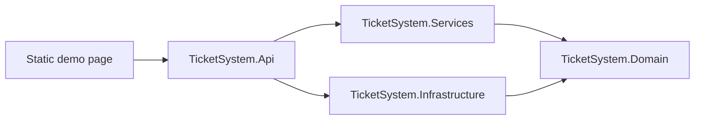

# Park Ticket System

Park Ticket System is a small reference application for exploring **Onion Architecture** and **Domain-Driven Design (DDD)** in a .NET API. It models a simplified park-ticket purchasing flow: browse parks and dated products, add products to a cart, assign ticket holders, complete payment, update inventory, and issue tickets.

> [!NOTE]
> The API design and separation of responsibilities are the focus of this project. The frontend is a quick, AI-generated static page included only as a convenient way to exercise the API; it is not intended as an example of frontend architecture or production UI development.

**[Open the live demo](https://parkticketsystem-bwb6ctbub6g3dbaj.westus2-01.azurewebsites.net/)**

## Architecture

The solution follows an onion architecture: dependencies point toward the domain, while infrastructure details remain at the outside edge.



The domain has no project references. Dependencies point inward:

| Project | Responsibility |
| --- | --- |
| `TicketSystem.Domain` | Aggregates, entities, value-oriented models, business rules, and repository interfaces |
| `TicketSystem.Services` | Application use cases, orchestration, result objects, and DTO mapping |
| `TicketSystem.Infrastructure` | JSON and in-memory repository implementations plus email providers |
| `TicketSystem.Api` | HTTP endpoints, dependency injection, configuration, and the static demo page |
| `TicketSystem.Tests` | Domain, service, and repository tests |

```text
TicketSystem.Api -> TicketSystem.Services -> TicketSystem.Domain
TicketSystem.Api -> TicketSystem.Infrastructure -> TicketSystem.Domain
```

### Persistence is Replaceable

Services use repository interfaces from the domain, not JSON, SQL, or other storage details. Infrastructure implements those interfaces through dependency injection. Persistence can therefore be replaced without changing the services, while tests can use in-memory fakes without a database or web server.

### Presentation is Replaceable

Services do not depend on controllers, HTTP, or HTML. The same services could support this API, Blazor, MVC, a desktop app, or another presentation framework. Domain objects stay internal; services expose only DTOs and result objects.

## Domain Model

- `Park` holds general information and owns a `ParkCalendar`.
- `ParkCalendar` manages monthly inventory made up of `DailyInventory` records.
- `DailyInventory` owns a product's quantity and price for one day.
- `Cart` holds `CartItem` records and their ticket-holder details. On payment, it validates the cart and creates `Ticket` records.

`ParkService` exposes park information and availability. `ShoppingService` manages the cart, payment, inventory updates, ticket creation, and ticket emails. Expected failures are returned as result objects rather than exceptions.

## API

| Method | Route | Purpose |
| --- | --- | --- |
| `GET` | `/api/parks` | List parks |
| `GET` | `/api/parks/{uniqueName}/availability/{year}/{month}` | Get monthly product availability |
| `POST` | `/api/cart/items` | Create a cart and add an item |
| `POST` | `/api/cart/{cartId}/items` | Add an item to an existing cart |
| `GET` | `/api/cart/{cartId}/items` | Get cart items |
| `DELETE` | `/api/cart/{cartId}/items/{productId}/{year}/{month}/{day}` | Remove a dated product from a cart |
| `POST` | `/api/cart/{cartId}/items/{cartItemId}/holder` | Assign a ticket holder |
| `POST` | `/api/cart/{cartId}/paid` | Complete the purchase and issue tickets |

The static page in `TicketSystem.Api/wwwroot/index.html` uses these endpoints directly and is served by the API application.

## Running Locally

### Prerequisites

- [.NET 8 SDK](https://dotnet.microsoft.com/download/dotnet/8.0)

### Start the application

The checked-in configuration selects SendGrid. For local development, use the fake email provider so checkout can be tested without credentials.

PowerShell:

```powershell
$env:Email__Provider = "Fake"
dotnet run --project TicketSystem.Api
```

Bash:

```bash
Email__Provider=Fake dotnet run --project TicketSystem.Api
```

Open the URL printed by ASP.NET Core. With the included launch profile, the HTTP address is typically `http://localhost:5111`.

Local JSON data is created under `TicketSystem.Api/App_Data`. Parks are seeded on first use, while carts, issued tickets, and inventory changes are persisted there between runs.

### Run the tests

```bash
dotnet test
```

## Configuration

ASP.NET Core configuration keys can be supplied through `appsettings` files, user secrets, or environment variables. Environment variable names use double underscores in place of colons.

| Key | Purpose |
| --- | --- |
| `Email:Provider` | `Fake` or `SendGrid` |
| `Email:SenderAddress` | Sender address used for issued-ticket emails |
| `Email:ApiKey` | Required when `Email:Provider` is `SendGrid` |
| `DataDirectory` | Optional override for JSON persistence |
| `APPLICATIONINSIGHTS_CONNECTION_STRING` | Enables Azure Monitor telemetry when configured |
| `AzureMonitor:SamplingRatio` | Controls the fraction of telemetry sent to Azure Monitor |

See [`docs/azure-application-insights.md`](docs/azure-application-insights.md) for Azure Application Insights setup and privacy considerations.

## Scope

This is an educational architecture sample, not a production ticketing platform. It intentionally keeps some outer-layer concerns simple:

- Products are defined by an in-memory repository.
- Parks, carts, inventory changes, and tickets use JSON-file persistence.
- The fake email provider supports local end-to-end testing.
- Payment is represented by a domain transition; no real payment gateway is integrated.
- The static frontend is a lightweight API client, not the architectural centerpiece.

These constraints keep attention on domain boundaries, dependency direction, testability, and the placement of business rules.
